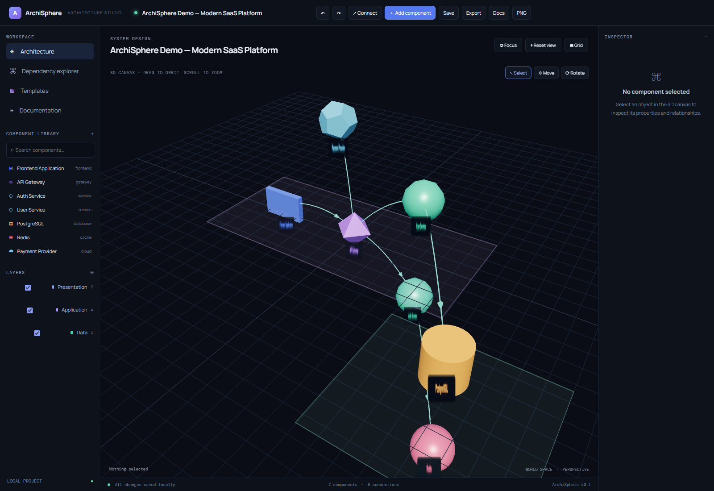

# ArchiSphere

**Visualize. Connect. Understand Your Architecture.**

ArchiSphere is a local-first 3D software architecture editor. Model components and directed dependencies in a browser-based Three.js scene; data stays in your browser unless explicitly exported.

## Full workspace preview

This full desktop view shows the editable sample architecture in the 3D canvas, component library, layer controls, inspector, and project actions. The illustrated topology is sample data, not production infrastructure.



## Verification

- `npm run build`: passed; Vite reports a JavaScript chunk over 500 kB.
- `npm test`: 7 passed.
- `npm audit --omit=dev`: 0 vulnerabilities.
- Browser save smoke check: passed; saved locally to IndexedDB.

**Scope:** Working local editor; limitations below are disclosed. No backend, multi-user service, or production security review.

---

## Start

```sh
npm install
npm run dev
```

Open the Vite URL (normally `http://127.0.0.1:5173`). Build with `npm run build`; unit tests: `npm test`.

## Current features

- Editable sample SaaS architecture; distinct 3D geometries, orbit/zoom camera, grid, layer zones, transform gizmo.
- Add, select, move, rotate, duplicate, delete and inspect components. Connections update on movement; connection mode links source to target.
- Three architecture templates; directed upstream/downstream graph traversal.
- IndexedDB project save/restore, debounced autosave, JSON schema `1.0.0` import/export, Markdown generation, scene PNG capture.
- Local custom template snapshot, layer visibility, keyboard shortcuts.

Sample topology is illustrative, not production infrastructure. Projects persist in this browser's IndexedDB; exports are user-controlled.

## JSON format

Root fields: `schemaVersion`, `project`, `layers`, `components`, `connections`. Imports are limited to 5 MB, checked for schema version, unique component IDs, finite coordinates, and valid connection references. Imported strings render escaped in the UI.

## Keyboard shortcuts

`Ctrl/Cmd+S` save · `Ctrl/Cmd+Z` undo · `Ctrl/Cmd+Shift+Z` redo · `Ctrl/Cmd+D` duplicate · `Delete` remove · `F` focus · `G` toggle grid · `Esc` deselect.

## Layout

`src/model.js` contains the architecture model, validation, graph traversal, sample data and docs generator. `src/main.js` wires application state, Three.js scene and controls, persistence and exports. `src/style.css` defines the responsive dark UI.

## Verification

`npm run build`, `npm test`, and `npm audit`.

## Limits / roadmap

This is an initial working release, not the full specification: currently no dedicated multi-project dashboard, project CRUD/recent-project picker, comprehensive undo/redo for every inspector edit, connection editor/deletion UI, custom layer CRUD/reorder, ten-template gallery, multi-select, orthographic camera, true transparent PNG option, dependency path visualization, Playwright E2E suite, or captured documentation screenshots. WebGL/GPU capability varies by browser. Add these in focused increments.

MIT License.
